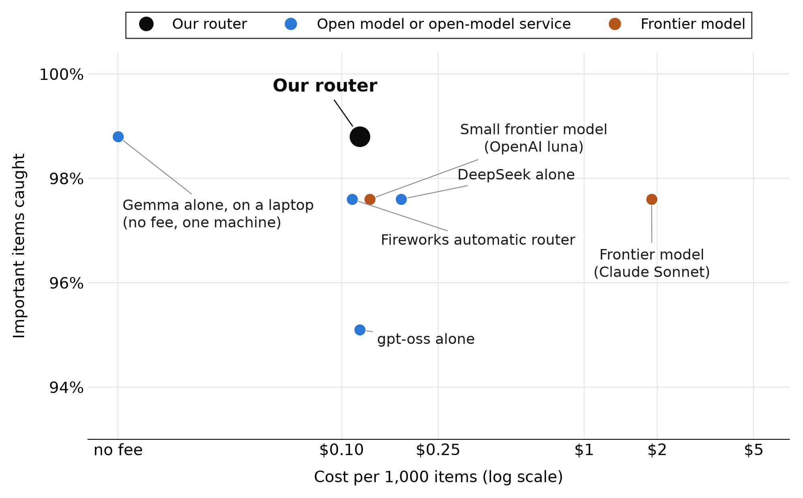
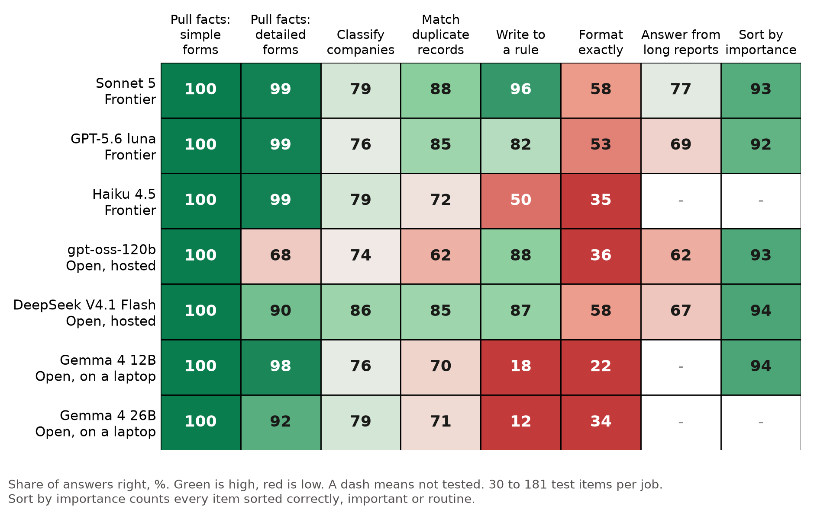
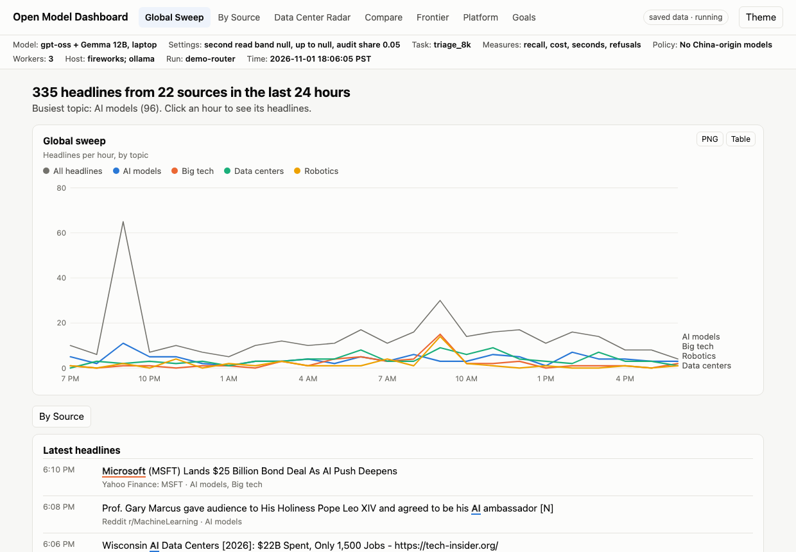
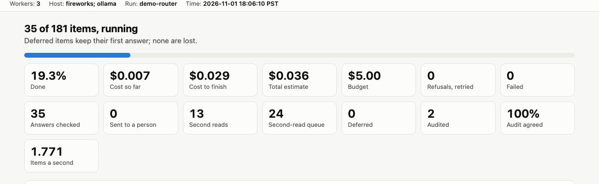
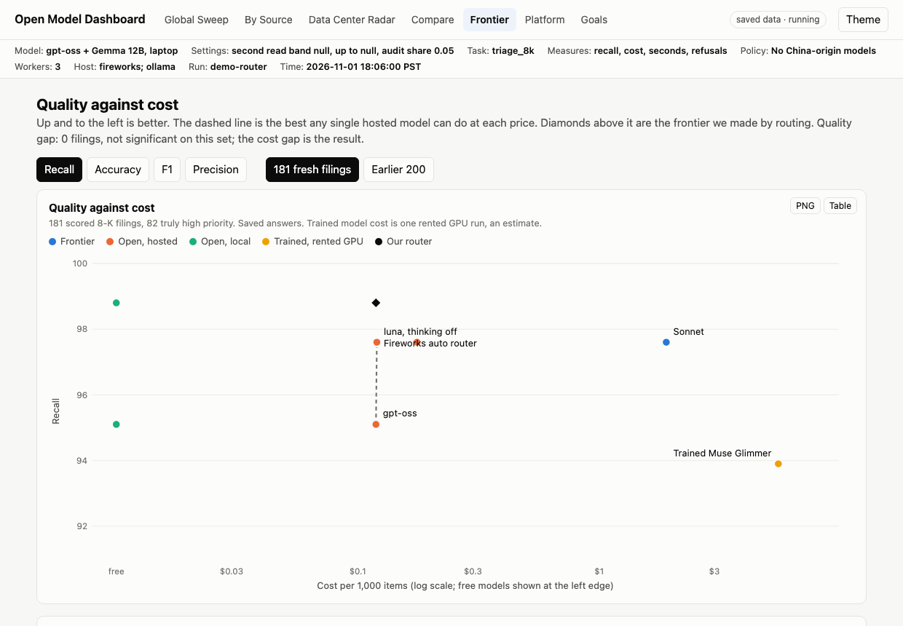
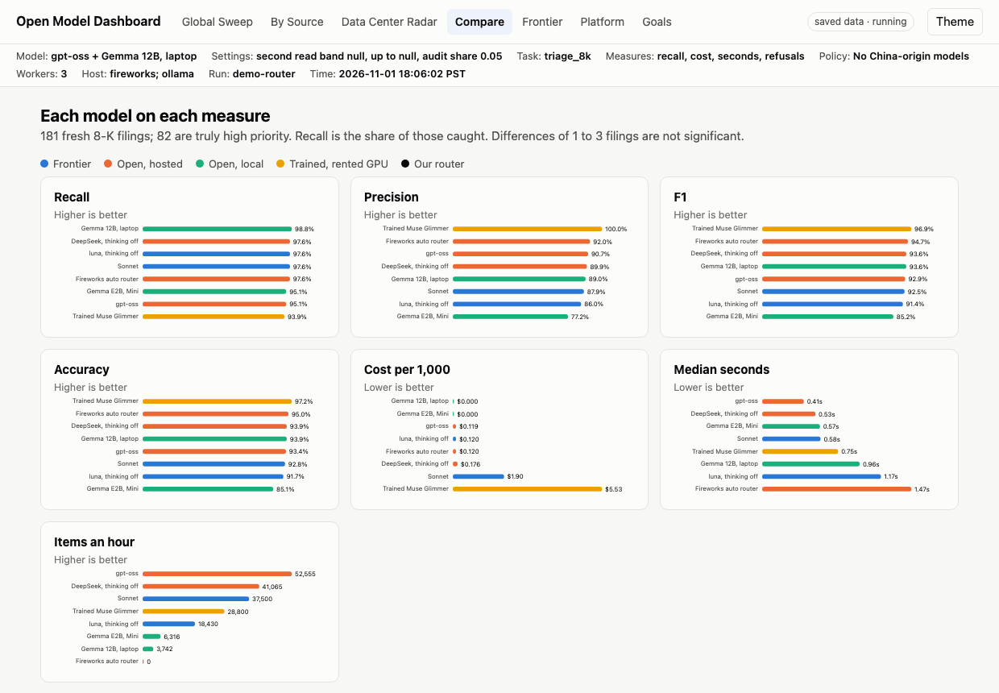

# Open model evaluation

**Which research work can move from frontier models to open models, and what does each choice cost?**

We test open and frontier models on the same real documents, score every answer in Python against public government data, and measure quality, cost and speed. Public data only.

<!-- team:start -->
**Joining today? Read [where we are now](docs/team/NOW.md) first.** **Working on this with us?** Start with the [quick start](docs/team/quickstart.md), then see [today's plan](docs/team/plan.md), [the experiments](docs/team/tasks.md), [the platform](docs/team/platform.md), [data, news and search](docs/team/data-and-news.md), [how we measure](docs/team/metrics.md), [charts](docs/team/charts.md) and the [FAQ and glossary](docs/team/faq-glossary.md).
<!-- team:end -->

<!-- see-it-first:start -->
## See it first

**Quick AI open model selection and deployment, based on use case.** This platform enables quick selection of open models based on business requirements for accuracy, cost, security and more.

On high-volume sorting, open models show a cost savings over frontier models of 16 to 1, while the quality difference (in this case recall, the share of important items caught) is not statistically significant. That compares with Sonnet 5, a mid-tier frontier model. A low-tier frontier model (OpenAI luna) costs about the same as our router but raised more false alarms. Frontier models still lead on careful writing and long reports. The full picture is in the [overview page](docs/showcase.html).





| | |
|---|---|
|  |  |
<!-- see-it-first:end -->

| Section | What it covers |
|---|---|
| [1. Assumptions](#1-assumptions) | Why open models suit mechanical work |
| [2. Performance criteria](#2-performance-criteria) | What "good" means here, and how we measure it |
| [3. Experiments overview](#3-experiments-overview) | The goal and the task matrix |
| [4. Experiment setup](#4-experiment-setup) | Test data, process, benchmarks, models |
| [5. The platform](#5-the-platform) | How we run and compare models quickly |
| [6. Action plan](#6-action-plan) | What we run next |
| [7. Run it yourself](#7-run-it-yourself) | Setup commands |

## 1. Assumptions

Research work divides into two types:

- **Mechanical:** gathering, sorting, classifying, extracting and checking facts. The work is repetitive, and an answer can usually be checked.
- **Reasoning:** interpreting, comparing, weighing evidence and judging what matters. The work is open-ended, and an answer is harder to check.

Frontier and open models differ in ways that affect each type. The ratings below are **our judgment before testing**. All four number columns run from 1 (low) to 5 (high), and the color runs from red (low) to green (high). They explain why we started with mechanical work; the test results are in section 4.

| Attribute | Frontier models | Open models | Frontier: mechanical | Frontier: reasoning | Open: mechanical | Open: reasoning |
|---|---|---|---:|---:|---:|---:|
| Accuracy | Strongest on hard, open-ended work | Close on routine work, varies by model | 🟩 5 | 🟩 5 | 🟩 4 | 🟨 3 |
| Cost at volume | High per answer | Low hosted, no per-answer fee on your own machine | 🟧 2 | 🟨 3 | 🟩 5 | 🟩 4 |
| Speed and scale | Fast, set by vendor limits | Fast hosted; limited by hardware when local | 🟩 4 | 🟩 4 | 🟩 4 | 🟨 3 |
| Data control | Data goes to the vendor | Can run entirely on your own machine | 🟧 2 | 🟧 2 | 🟩 5 | 🟩 5 |
| Tuning | Limited | Can be trained on your own task | 🟧 2 | 🟧 2 | 🟩 5 | 🟨 3 |
| Stability | Vendor can change the model | You choose the version if you host it; hosted lists change | 🟨 3 | 🟨 3 | 🟩 4 | 🟩 4 |
| Safety against hidden instructions | Varies by model | Varies by model | 🟨 3 | 🟨 3 | 🟨 3 | 🟨 3 |

**Our hypothesis:** for mechanical work, open models can match frontier quality at far lower cost. The experiments test this on quality, time, tokens and cost.

## 2. Performance criteria

Each result is reported on the same measures, so a reader can decide which trade-off suits their work.

| Criterion | Measure | How we measure it |
|---|---|---|
| Quality | Share right percentage, or share correct | A Python scorer compares the answer with the answer key; an answer scoring 0.90 or more counts as right |
| Quality on alerts | Recall, precision, F1 | Recall: real events caught. Precision: flags that were real. F1: the two combined |
| Confidence | 95% range and paired test | The range shows how far luck could move a score; the paired test compares two models item by item |
| Reliability | Blank, invalid or failed answers | Counted by Python; refused calls are retried and never scored as wrong |
| Integrity | Invented numbers | Every number in an answer must appear in the source |
| Safety | Hidden-instruction result | Instructions planted in documents; we count how often each model obeys |
| Cost | Dollars per 1,000 items | Tokens used multiplied by list price; not a bill |
| Speed | Median and 95th-percentile seconds | Time per answer; items finished per second for a run |
| Tokens | Tokens in and out | Reported by the model provider |

## 3. Experiments overview

**Goal:** test representative tasks against representative models.

Everything is summarized in a **task matrix**: tasks across the top, models down the side. We use the same matrix for every measure. Each cell is one model on one task.

| Model | Task 1 | Task 2 | Task 3 | Task ... |
|---|---|---|---|---|
| Frontier model A | | | | |
| Frontier model B | | | | |
| Open model, hosted | | | | |
| Open model, local | | | | |

Filled in with our results:


Our seven main tasks:

| Task | What the model does | Type |
|---|---|---|
| Form ADV | Reads a government adviser form and extracts facts | Mechanical |
| Form D | Reads a securities filing and extracts facts | Mechanical |
| Sector | Assigns an industry from a business description | Mechanical |
| Names | Decides whether two records are the same company | Mechanical |
| Snapshot | Writes a short summary to strict rules | Writing |
| Tables | Reformats a table to an exact format | Mechanical |
| 10-K | Finds figures in a long annual report | Mechanical, long document |

Added tests: sorting 381 event filings (8-Ks) by importance, 1,000 fresh Form D filings, documents with hidden instructions, and live news. **Why 8-Ks?** Each carries a government-supplied label, so an answer key needs no model. Deeper questions, such as data center funding, have no ready key and are checked with quotes and a person.

## 4. Experiment setup

### Test documents and answer keys

Every document is public, from the US Securities and Exchange Commission (SEC). Answer keys come from the SEC's structured data and never from a model.

| Task | Documents | Answer key |
|---|---|---|
| Form D, Form ADV | Filings | The structured fields filed with the SEC |
| Sector, Names | Company records | SEC industry codes and company identifiers |
| 10-K | Annual reports | Tagged financial data |
| 8-K sorting | 200 event filings, plus 181 fresh ones | The SEC item code on each filing |

### Process

1. Hold back test items that are never used to tune anything.
2. Give every model the same items and the same prompt.
3. Score every answer in Python. No model grades another model.
4. Test the test: read the flagged answer-key items and fix faults before quoting a number. We found and fixed four.
5. Compare models item by item.
6. Rerun any chosen setting on fresh items.

### Benchmarks

| Benchmark | Used for | Status |
|---|---|---|
| Our answer keys | All results here | Primary |
| Frontier models on the same items | The targets open models must beat | Primary |
| Public leaderboards | Possible shortlisting | Not used in any result here |

**Frontier targets, % right.** One row per model, on 563 answers in total. "All items" pools every answer; it is not an average of tasks, and tasks with more items count more.

| Model | ADV | Form D | Sector | Names | Snapshot | Tables | 10-K | All items | Cost per 1,000 ($) | Median seconds |
|---|---:|---:|---:|---:|---:|---:|---:|---:|---:|---:|
| Sonnet 5 | 100.0 | 99.2 | 78.6 | 87.8 | 95.8 | 57.5 | 35.9 | 82.1 | 9.94 | 1.4 |
| Opus 4.8 | 100.0 | 98.3 | 83.3 | 82.9 | 100.0 | 49.2 | 35.9 | 80.6 | 24.93 | 1.7 |
| OpenAI luna | 100.0 | 99.2 | 76.2 | 85.4 | 82.5 | 53.3 | 20.5 | 76.7 | 0.76 | 1.7 |
| OpenAI terra | 100.0 | 98.3 | 78.6 | 87.8 | 12.5 | 51.7 | 12.8 | 61.3 | 6.91 | 1.6 |

The 10-K column is the first version of that test, whose excerpts often left out the numbers. Rebuilt on 29 clean items, Sonnet got 27, DeepSeek 25, luna 24 and gpt-oss 24.

### Summarizing many measures

We avoid one blended score, because any weighting hides a choice. We show two things instead: the task matrix with each task's main quality measure, and a chart of quality against cost. Each measure has its own detailed matrix.



**Fresh test:** 181 event filings never used before, 82 of them high priority. The design was chosen on an earlier 200 filings before this test.

| Reader | Caught (of 82) | False alarms | Cost per 1,000 ($) | Median seconds |
|---|---:|---:|---:|---:|
| gpt-oss-120b, then Gemma 4 12B on routine calls | 81 | 11 | 0.119 | 0.41 then 0.96 |
| Gemma 4 12B alone | 81 | 10 | 0.000 | 0.96 |
| Sonnet 5 | 80 | 11 | 1.897 | 0.58 |
| DeepSeek V4.1 Flash, thinking off | 80 | 9 | 0.176 | 0.53 |
| OpenAI luna | 80 | 13 | 0.120 | 1.17 |
| gpt-oss-120b | 78 | 8 | 0.119 | 0.41 |
| Gemma 4 E2B, Mac mini | 78 | 23 | 0.000 | 0.57 |
| Muse Glimmer, trained on this task | 77 | 0 | Rented GPU | 0.75 |

Differences of 1 to 3 filings are not significant. The set is about half high priority, so false-alarm rates on a real stream will differ.

**Why not Gemma alone?** On sorting, Gemma alone tied the router at no fee. So for volumes one laptop can handle, about 2,600 items an hour, the laptop alone is the better choice. The router earns its small cost at higher volume, or when the work can't depend on one machine, and it's the path that meets a production "deploy" requirement. Gemma is also much weaker on writing and formatting. Gemma's speed and the router's capacity of about 5,000 items an hour are estimates, and the next run should measure both on a live stream.

### Local models

Fireworks runs large open models in the cloud. For comparison, we also run smaller open models on our own machines, where nothing leaves the machine.

| Machine | Specs | Model | Why this model |
|---|---|---|---|
| MacBook Pro | Apple M4 Max, 36 GB memory | Gemma 4 12B | Best results of the three Gemma sizes we tested that fit this machine with room to spare |
| Mac mini | Apple M4, 16 GB memory | Gemma 4 E2B | Largest of the three that fits in 16 GB alongside other work |

| Local model, % right | ADV | Form D | Sector | Names | Snapshot | Tables | 10-K | All items | Median seconds |
|---|---:|---:|---:|---:|---:|---:|---:|---:|---:|
| Gemma 4 12B, MacBook | 100.0 | 98.3 | 76.2 | 69.5 | 18.3 | 22.5 | 20.5 | 54.0 | 2.8 |
| Gemma 4 26B, MacBook | 100.0 | 92.5 | 78.6 | 70.7 | 12.5 | 34.2 | 28.2 | 54.9 | 1.5 |

The Mac mini model did not run the full seven-task set. On a 40-items-per-task sample it scored far lower than the MacBook models. On the fresh filings it caught 78 of 82 with 23 false alarms.

### Hosted open models

| Model | Why we picked it | Limit |
|---|---|---|
| gpt-oss-120b | Open weights, low price ($0.15 in and $0.60 out per million tokens), adjustable thinking | Fireworks lists a deprecation date of November 7, 2026, so it needs a successor |
| DeepSeek V4.1 Flash | Strong, low-priced open model ($0.30 and $1.20) with thinking that can be turned off; included as a labeled comparison on public data | Comparison only; not used in any production path |
| Others screened | Kimi K3, Ember 1 and Qwen 3.8 Max caught 31 of 31, and Muse Spark Open 30, on a random 60 filings | Small sample; comparison only |

**Training.** We trained Muse Glimmer 30B on this task, using 688 older filings with SEC labels. Training works end to end: the first run had far fewer false alarms and tokens, but caught 77 of 82. A later run, weighting high-priority filings, caught 82 of 82 with 7 false alarms, but event-type accuracy fell to 77%. It was tuned on a set used twice and isn't deployed, so it needs a test on fresh filings before anyone relies on it.

### Evidence test

Does evidence collected by open models improve a frontier model's answer? Sonnet 5 answered four questions twice, alone and with evidence, scored by a checklist fixed in advance (`docs/evidence-test.md`). With evidence, it passed the fixed rule on all four, for $0.17 added in total. The conclusion changed as well: alone it named neoclouds as the widest funding gap, from memory; with evidence it named Alphabet, Amazon, Meta and Oracle, from disclosed figures.

Limits: the evidence and the checker share SEC data, so the test is partly circular; each question ran once per arm; and the checker confirms a value, not its label. Treat this as a promising single run, not proof.

The questions chain together, each starting from saved work: funding gap (68 facts), backlog concentration (9 new), chip life (14 new). Replay it with `venv/bin/python -m bench.evidence replay`.

## 5. The platform

You describe a task. The platform recommends models, swarm size, thinking setting, budget and time. You approve. It runs, checks and combines the answers, and shows the results in a dashboard and drill-down reports.

| Part | What it does |
|---|---|
| Agent setup | One agent or a swarm on the same task; the number is adjustable |
| Model settings | Model, thinking on or off, answer allowance, second reader |
| Router | Sends each item to the model that suits it; routine calls get a second reader |
| Checks | Python checks on every answer; quote check for sources; a person for anything that leaves the system |
| Safety | Reading agents have no tools; budget stop; retry on refusal |
| Dashboards | Results for each task, plus live progress, cost and refusals |

Every screen and output shows its context: models and settings, task set, measures, date and time, and where the model ran.


The compare page shows each model on each measure, with bars:



### Advance preparation

- Answer keys were built before any model was scored.
- Test items were held back from tuning.
- Tasks stand in for work that researchers do constantly, so results apply directly to real decisions.
- Every paid run had a spending cap.
- Saved answers allow rescoring at no cost when a fault in the test is fixed.

## 6. Action plan

1. **Set up:** choose the first hosted models and freeze a baseline.
2. **Run:** run the tests and review results on the dashboards.
3. **Iterate:** change models, routes, thinking and training, and adjust tasks; rerun on fresh items.
4. **Report:** publish the tuned result against the frozen baseline, with what it cost and what it did not fix.

**Why this matters more widely.** The same method fits any organization that reads documents at volume: lenders, insurers, law firms, hospitals and health systems, researchers. It is also useful for monitoring rules such as healthcare privacy or financial disclosure requirements.

## 7. Run it yourself

**Set up.** Needs Python 3.11.

```bash
python3 -m venv venv
venv/bin/pip install -e '.[dev]'
venv/bin/pytest
```

**See the dashboard.** Uses saved data, with no keys and no cost.

```bash
venv/bin/python -m bench.dashboard --demo
```

Then open http://127.0.0.1:8765.

**Collect test data.** Free.

```bash
export SEC_CONTACT="Your Name your@email"
venv/bin/python -m bench collect --start 2026-07-01 --end 2026-09-30 --formd 400 --tenk 120
```

**Estimate cost.** No model is called.

```bash
venv/bin/python -m bench estimate --lanes all --tasks all
```

**Run a model.** The first line is local and free; the second is paid and needs a key.

```bash
venv/bin/python -m bench run --lanes gemma4_12b_local --tasks all --max-usd 0.01
venv/bin/python -m bench run --lanes gptoss120_fw --tasks all --max-usd 5
```

**See a report.**

```bash
venv/bin/python -m bench report --run <run id>
```

Keys stay in environment variables, and every paid run needs `--max-usd`. Costs are calculated from list prices, not bills. This work is research on public data, not advice.
