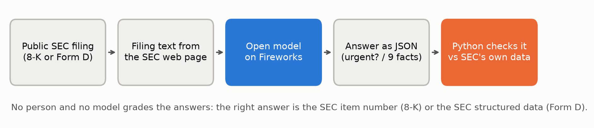
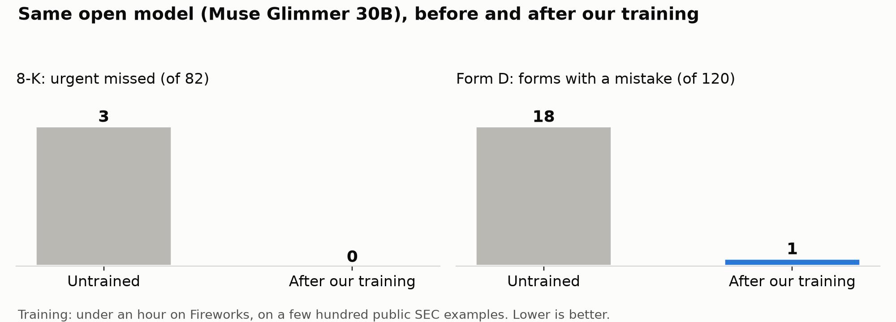
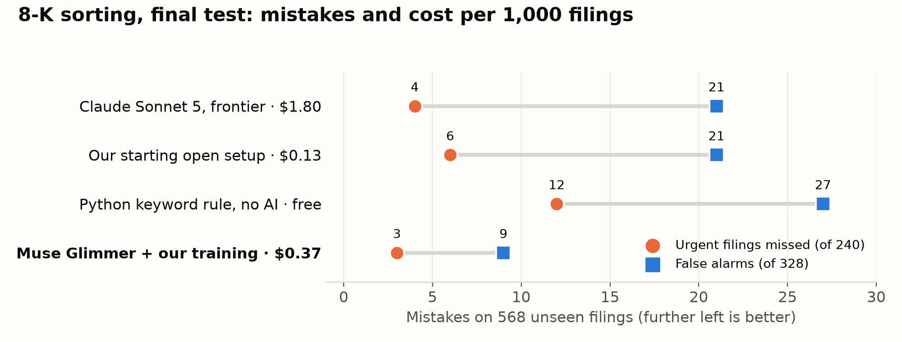
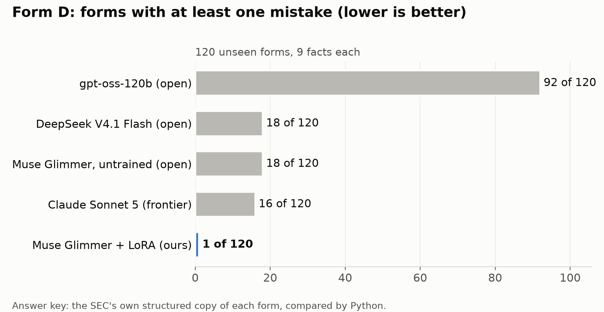
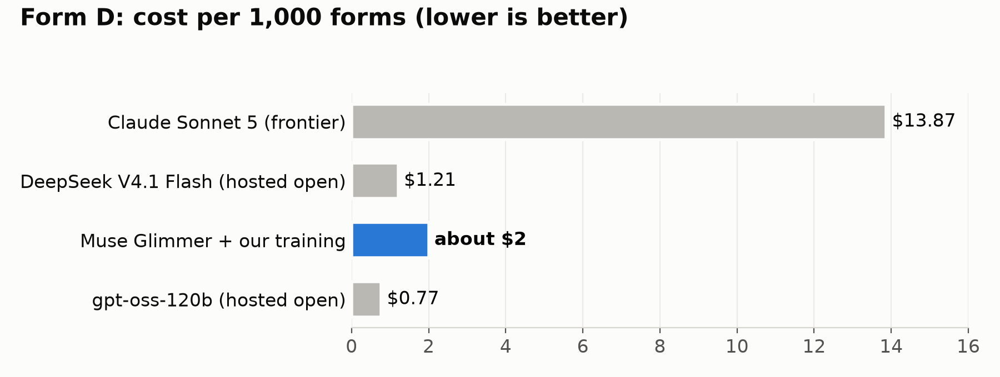
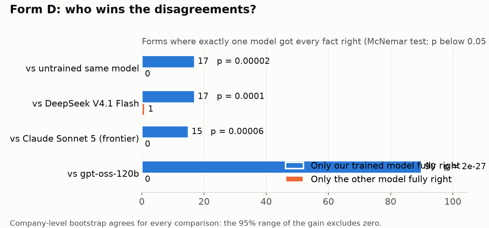
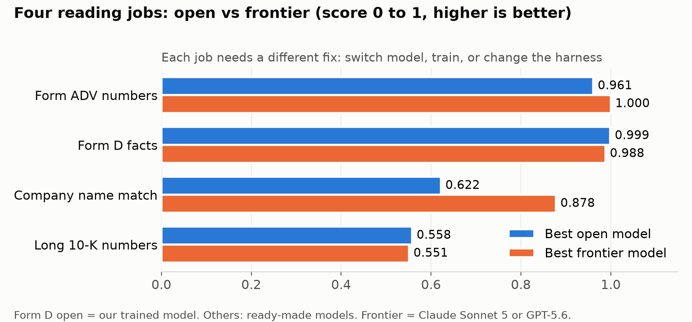

# Open models beat a frontier model on finance reading, at a fifth of the cost

**Goal:** use open models wherever they are good enough, prove it against a frontier model on the same held-out documents, improve the open model, and report the net result.

**Result:** a small open model (Muse Glimmer 30B), trained on Fireworks in under an hour on a few hundred public SEC examples, beat Claude Sonnet 5 on both jobs we tested, on documents it never saw:

| | 8-K sorting (568 filings) | Form D extraction (120 forms) |
|---|---|---|
| Mistakes vs frontier | Urgent missed **3 vs 4**; false alarms **9 vs 21 (−57%)** | Forms with a mistake **1 vs 16 (−94%)** |
| Overall | **97.9% vs 95.6%** right (McNemar p = 0.02) | Score **0.999 vs 0.988** (McNemar p = 0.00006) |
| Cost per 1,000 | **$0.37 vs $1.80** (about 5× cheaper) | **about $2 vs $13.87** (about 7× cheaper) |

## 1. Two jobs, graded exactly



| | 8-K sorting | Form D extraction |
|---|---|---|
| Document | Form 8-K: a company announces a major event in plain sentences | Form D: a private fundraising notice, a fill-in form with boxes and tick marks |
| Model reads | The announcement's text only; the SEC item number and headings are removed | The text of the form's SEC web page: labels, tick marks and values, flattened into lines |
| Model answers | Urgent or routine | 9 facts: issuer name, state and year of incorporation, related persons, industry group, date of first sale, amount offered, amount sold, number of investors |
| Answer key | The SEC item number the company declared. Urgent: 1.03 bankruptcy, 1.05 cyber incident, 2.01 acquisition or sale, 3.01 delisting, 4.02 restatement, 5.02 leadership change | The SEC's own structured copy of the same form, compared field by field by Python |

We chose jobs where the SEC publishes the right answer so that no person and no model grades the answers. The skills carry over to documents without an answer key: judging an event from plain sentences, and reading messy form layouts where labels, tick marks and values are separated.

## 2. Baselines: every model, same instructions, same documents

**8-K sorting (practice: 181 filings, 82 urgent)**

| Model | Urgent missed | False alarms | Cost per 1,000 |
|---|---|---|---|
| Claude Sonnet 5 (frontier) | 2 | 11 | $1.90 |
| DeepSeek V4.1 Flash (hosted open) | 2 | 9 | $0.18 |
| gpt-oss-120b (hosted open) | 4 | 8 | $0.12 |
| Gemma 4 12B (laptop, free) | 1 | 10 | $0.00 |
| Python keyword rule (no AI) | 6 | 10 | $0.00 |

**Form D extraction (120 unseen forms)**

| Model | Forms with a mistake | Score | Cost per 1,000 |
|---|---|---|---|
| Claude Sonnet 5 (frontier) | 16 | 0.988 | $13.87 |
| DeepSeek V4.1 Flash (hosted open) | 18 | 0.986 | $1.21 |
| Muse Glimmer 30B, untrained | 18 | 0.987 | |
| gpt-oss-120b (hosted open) | 92 | 0.899 | $0.77 |

Hosted open models were already close to the frontier model at a fraction of the price. None, frontier included, was free of mistakes.

## 3. What we changed, and what it did

| Type | Change | Job | Before → after | Verdict |
|---|---|---|---|---|
| Harness: routing | gpt-oss reads, Gemma double-checks routine calls | 8-K (practice) | Missed 4 → 1; false alarms 8 → 11 | Mixed |
| Harness: routing | Best of 91 model pairings | 8-K (practice) | Best: 1 missed; none reached 0 | Ceiling |
| Harness: settings | Thinking on, DeepSeek | Form D (practice) | 34 of 40 → 28 of 29 fully right; 4× cost, 14× slower | Poor value |
| Harness: settings | Thinking on, gpt-oss | Form D (practice) | Score 0.906 → 0.404 | Worse |
| Model choice | Cheaper model (Nemotron Lightning) | Form D (practice) | Score 0.553 | Worse |
| Model choice | Newer open model (Inkling) | 8-K (practice) | Missed 2, false alarms 7, at $2.87 per 1,000 | Worse value |
| **Training (LoRA)** | Train on 688 labelled filings, urgent examples shown twice | 8-K (practice) | Missed 3 → 0; false alarms 6 → 4 | **Better** |
| **Training (LoRA)** | Train on 280 forms | Form D (120 unseen) | Forms with a mistake 18 → 1; score 0.987 → 0.999 | **Better** (p = 0.00002) |
| **Training (LoRA)** | Train again from scratch | Form D | 0.999 again | **Repeatable** |



Prompts, settings, routing and model swaps hit a ceiling or made things worse. Training was the change that moved both jobs. On Form D the errors sat in fields that need reading the form's layout: industry group (about 40 ticked categories) was right on 49 of 120 forms for gpt-oss, 107 for DeepSeek and 120 after training.

## 4. Final test: run once, on unseen documents, after the design was locked



| 8-K, 568 unseen filings (240 urgent) | Urgent missed | False alarms | Right overall | Cost per 1,000 |
|---|---|---|---|---|
| Python keyword rule (no AI) | 12 | 27 | | free |
| Our starting open setup (gpt-oss + Gemma) | 6 | 21 | 95.2% | $0.13 |
| Claude Sonnet 5 (frontier) | 4 | 21 | 95.6% | $1.80 |
| **Muse Glimmer + our training** | **3** | **9** | **97.9%** | **$0.37** |





**Significance.** We call a gain real only when two tests agree. McNemar counts the documents where exactly one system was right; the bootstrap redraws the set of companies 5,000 times.

| Comparison | Only ours right | Only the other right | McNemar p | Bootstrap 95% range |
|---|---|---|---|---|
| 8-K: vs frontier | 20 | 7 | 0.02 | Accuracy +0.6 to +4.1 points; false alarms −3 to −21 |
| 8-K: vs our starting setup | 21 | 6 | 0.006 | Accuracy +0.9 to +4.4 points |
| Form D: vs frontier | 15 | 0 | 0.00006 | Score +0.006 to +0.019 |
| Form D: vs same model untrained | 17 | 0 | 0.00002 | Score +0.007 to +0.018 |



**In business terms:** the frontier model left 13% of forms needing a person to fix them; ours under 1%. At 10,000 forms a month that is about 1,300 fixes vs about 80. On 8-K, ours raised less than half the false alarms at a fifth of the cost.

**Limits.** Our 8-K target, set before the final run, was at most 2 misses; we missed 3. The one extra urgent filing caught over the frontier model is not significant on its own; the 8-K gain is fewer false alarms at lower cost. A trained model is served on a rented GPU (about $10 an hour, about 4 minutes to start), so it suits batches. Form D has a structured copy at the SEC; the real use is documents without one.

## 5. No single best model



| Job | Best open | Best frontier | Fix |
|---|---|---|---|
| Form ADV numbers | 0.961 | 1.000 (two models: $2.24 and $22.28 per 1,000) | Pick the cheapest model that passes |
| Form D facts | 0.999 (trained) | 0.988 | Train an open model |
| 8-K sorting | 97.9% right (trained) | 95.6% | Train an open model |
| Company name matching | 0.622 | 0.878 | Frontier leads; next to train |
| Long 10-K numbers | 0.558 | 0.551 | Change the harness: Python reads tables, the model points |

Because the best choice differs by job and changes with every new model, this analysis has to repeat. The platform in this repo makes that routine: add a model or a test set in one line; every answer, cost and speed is saved; significance tests are built in; and policies such as "no China-origin models" or "nothing leaves the laptop" are one-line settings.

## Reproduce

```bash
python3 -m venv venv && venv/bin/pip install -e '.[dev]'
venv/bin/pytest -q                                     # 65 checks
venv/bin/python -m bench.router combos                 # rank 91 model pairings on saved answers, free
venv/bin/python -m bench.stats --set triage_8k_final99 \
  --before run:frontier-final99:sonnet5 --after file:results/tuned-final99.jsonl
```

Every run saves one row per document under `results/`, so every number above can be re-checked without calling a model. Data: [DATA.md](DATA.md). Experiments: [experiments/](experiments/).

## Conclusions

1. A small trained open model beat the frontier model on both jobs, at a fifth to a seventh of the price.
2. Training is the lever: prompts, settings and routing hit a ceiling; a few hundred examples and under an hour of training broke through.
3. Hosted open models are already close to the frontier model and far cheaper, even before training.
4. There is no single best model; measure each job, then train, re-route or switch to the cheapest model that passes.

---

# finance bros: a penny analyst on open models

**Fireworks Deploy Buildathon, San Francisco, 2026-11-02.**

**Result:** a small open model, trained on public SEC data, reads private-fundraising filings (Form D) at **0.999** accuracy on 120 forms it never saw, up from **0.987** for the same model untrained above every ready-made open model we tested (DeepSeek V4.1 Flash 0.986, gpt-oss-120b 0.899), and above the frontier model Claude Sonnet 5 (0.988, at $13.87 per 1,000 forms; trained model right on 15 forms it missed, 0 the other way, p = 0.00006). The gain is statistically real (McNemar p = 0.00002 against the untrained model; company bootstrap excludes zero).

## The problem
Finance analysts read thousands of SEC filings a week: fundraising forms to pull facts from, and event filings where missing an urgent one is costly. Frontier models can do this, but at volume they are expensive and the data leaves your control. Our question: can a small open model, trained for the job, match a frontier model's accuracy at a fraction of the price and time?

## What we measured
Every system is scored on the same fixed held-out test set, on three dimensions:

| Accuracy | Price | Speed |
|---|---|---|
| Score against the SEC's own structured data | $ per 1,000 items | Median and p95 seconds per item |

## Experiments
| # | Experiment | Result |
|---|---|---|
| 01 | [Forms extraction](experiments/01-forms-extraction/): 9 facts from a Form D | 0.999 trained vs 0.987 untrained, two training runs |
| 02 | [Sorting 8-K filings](experiments/02-sorting-8k/): urgent or routine | On 568 unseen filings: 3 urgent missed vs 4 for the frontier model, false alarms 9 vs 21 (p = 0.02), $0.37 vs $1.80 per 1,000 |
| 03 | [Forms on GLM 5.3 Flash](experiments/03-forms-glm-lora/): fully serverless training and inference | Baseline 0.944, $1.16 per 1,000 |
| 04 | [Forms router](experiments/04-forms-router/): rules first, model as fallback | Planned |

Each folder has the task, the data, every system we tried (failures included), the significance tests and the commands to reproduce.

## Reproduce
```bash
python3 -m venv venv && venv/bin/pip install -e '.[dev]'
venv/bin/python -m bench.starter      # unpack the public SEC test sets
venv/bin/pytest -q                     # 65 checks
export FIREWORKS_API_KEY=...           # never commit it
```
Then follow the commands in each experiment folder. Every run saves one row per test item under `results/`, so every number can be checked without re-running a model. Data sources: [DATA.md](DATA.md).

## Team
finance bros, a team of four. Names are kept out of this repo on purpose.

## Disclosure
The scoring bench, the test sets and earlier runs were built before today in a team member's [open-model-eval](https://github.com/gvm-agents/open-model-eval) (full description: [docs/bench-overview.md](docs/bench-overview.md)). Built today: the trained Forms models, the final Sorting run, experiments 03 and 04, and this write-up. We used AI coding assistants (Claude Code) throughout. Public data only.

Demo video: link follows.
